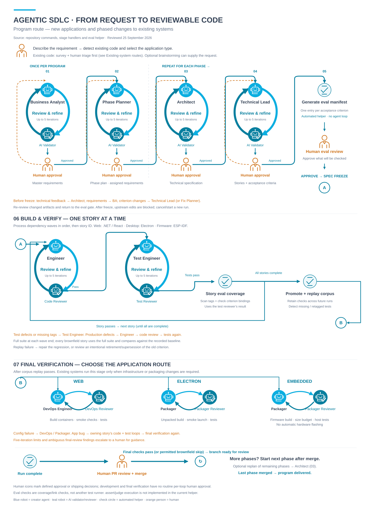
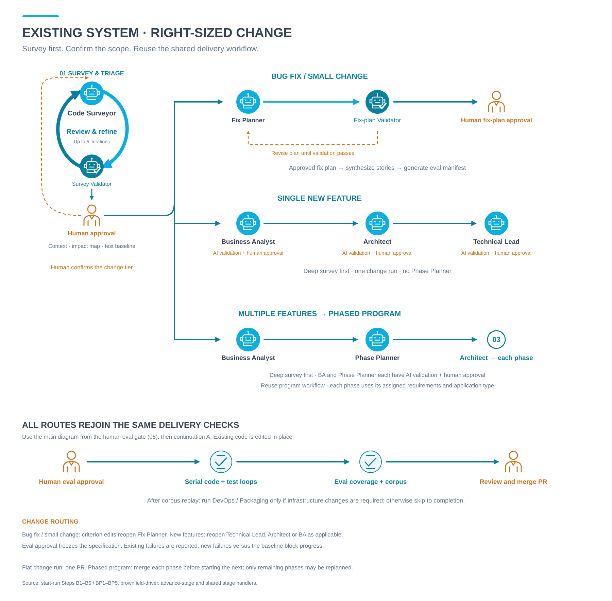

# Agentic SDLC — workflow big picture

The repository workflow is the source of truth for these diagrams. The original sketch informed only the visual style: circular loops, agent icons, human icons and curved arrows. Workflow files were read, not modified.

## Diagrams

| View | SVG | PNG |
| --- | --- | --- |
| Complete program lifecycle | [Program workflow](workflow.svg) | [Preview](workflow.png) |
| Existing-system entry routes | [Brownfield workflow](brownfield-workflow.svg) | [Preview](brownfield-workflow.png) |

[Open both pages in draw.io](workflow.drawio). [Mermaid logical model](workflow.mmd) includes the branches and feedback routes. [Source mapping and corrections](interpretation.md) records the evidence and ambiguities.





## Read the main diagram

1. Capture the request and detect whether application code already exists. Existing systems first go through survey and human triage; use the companion view to choose the route.
2. For programs, the Business Analyst and Phase Planner run once, each with an AI validator and human approval. Every phase begins with Architect, then Technical Lead, with validation and approval of their artifacts.
3. Generate the eval manifest from approved story criteria. Human eval approval freezes the specification. This is a human gate, not an Evaluation-agent loop.
4. Follow continuation **A**: process one story at a time through Engineer → Code Reviewer → Test Engineer → Test Reviewer → automated criterion coverage check. Review failures return to the responsible agent. Complete all stories, then promote and replay the permanent eval corpus.
5. Follow continuation **B**: web uses DevOps; Electron and embedded use Packaging. For existing systems, this stage runs only if infrastructure or packaging changes are required.
6. A completed run produces a reviewable branch. The human opens/reviews/merges its PR. The next program phase starts only after merge confirmation, with optional replanning of remaining phases. There is no automatic next phase or production deployment.

Solid arrows show progress. Circular arrows show creator/reviewer revision. Orange dashed arrows show requested changes. Numbered stages and A/B continuation markers connect sections without long crossing lines. The companion diagram abbreviates some repeated validation/approval loops with explicit labels.

## Scope and fidelity

The views cover program setup, planning, eval approval, development, final verification, PR handoff, phase continuation, and all three brownfield tiers. Optional brainstorming and operational commands are documented in the source notes. Internal state writes, commit commands, prompts and retry-counter bookkeeping remain in the workflow definitions.

The current eval helper checks test-tag completeness and corpus link retention. It does not execute tests itself, and it does not execute `assert` probes or `judge` rubrics. Test execution is owned by test reviewers and final verification reviewers. See the source notes for discrepancies between the workflow prose and helper implementation.

## Editing and regeneration

Use **SVG for sharing** and the **two-page draw.io file for visual layout edits**. Draw.io text is editable; each icon and curved arrow is a movable/scalable vector image. Editing the internal artwork or curvature requires the Python source or a vector editor. Mermaid is a logical companion rather than a copy of the infographic layout.

The generator uses only the Python standard library:

```powershell
python docs/big-picture/generate_diagram.py
```

[generate_diagram.py](generate_diagram.py) provides drawing primitives and [diagram_layout.py](diagram_layout.py) defines the layouts. Regeneration overwrites both SVGs and `workflow.drawio`; it does not overwrite PNG previews. Use [render-previews.ps1](render-previews.ps1) to refresh those using installed Chrome or Edge. Manual draw.io edits should instead be exported from draw.io.

[workflow-source-hashes.json](workflow-source-hashes.json) records the plugin file hashes captured during this review, so the diagram can be checked against the source snapshot. Review date: **25 September 2026**.
