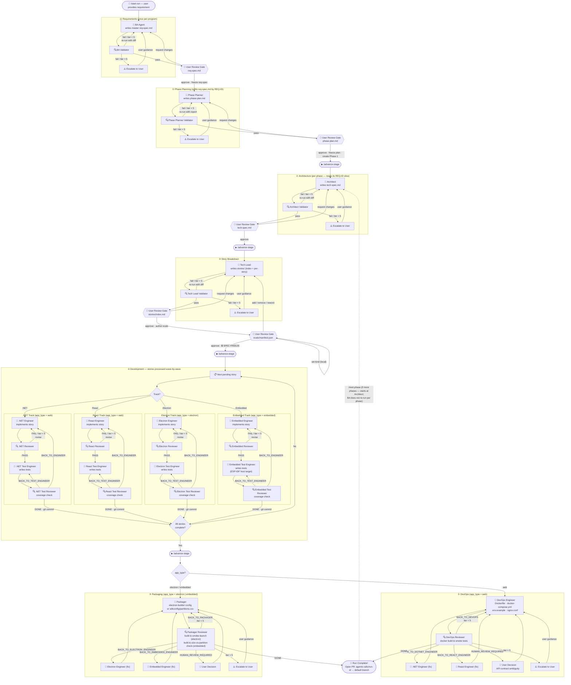
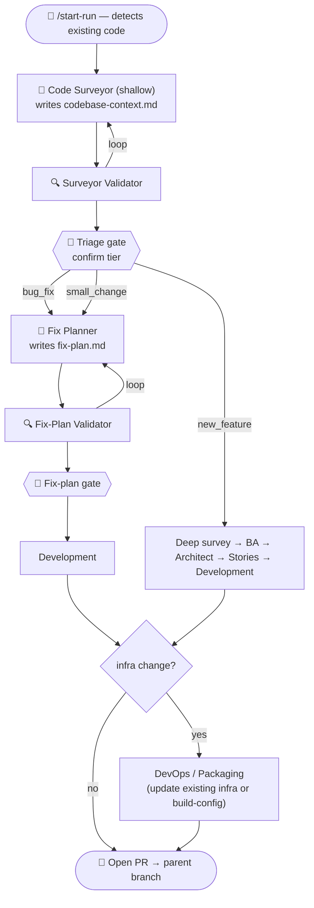

# Agentic SDLC Plugin

A multi-agent SDLC pipeline for Claude Code. Takes a plain-language requirement and produces a runnable .NET + React application through a pipeline of specialized AI agents.

## What it does

Each stage of the SDLC is handled by a specialized AI agent with a paired validator that loops until the output is correct (up to 5 iterations) before any human review.

| Stage | Agent | Validator |
|---|---|---|
| Codebase survey (brownfield) | Code Surveyor | Code Surveyor Validator |
| Requirements (once per program) | Business Analyst | BA Validator |
| Phase planning (splits the req-spec by REQ-ID) | Phase Planner | Phase Planner Validator |
| Architecture (per phase) | Architect | Architect Validator |
| Story breakdown | Tech Lead | Tech Lead Validator |
| .NET backend (web) | .NET Engineer + Reviewer | .NET Test Engineer + Reviewer |
| React frontend (web) | React Engineer + Reviewer | React Test Engineer + Reviewer |
| Desktop app (electron) | Electron Engineer + Reviewer | Electron Test Engineer + Reviewer |
| Firmware (embedded) | Embedded Engineer + Reviewer | Embedded Test Engineer + Reviewer |
| Containerization (web) | DevOps Engineer | DevOps Reviewer |
| Packaging (electron / embedded) | Electron/Embedded Packager | Electron/Embedded Packager Reviewer |

## Workflow diagram



## Core principles

1. **Requirement spec is the source of truth.** Every artifact traces back to it.
2. **Creator + Validator pattern.** Every agent that produces an artifact has a paired validator.
3. **Spec freeze at story dispatch.** Once development begins, upstream specs are immutable.
4. **Single-language tracks.** Web runs develop `.NET` and `React` in parallel (logically); electron runs use one `electron` track; embedded runs use one `embedded` track.
5. **Runnable definition of done.** Complete only when `docker compose up` produces a working app.

## Application archetypes

Every **phase** targets one **application archetype**, recorded as `app_type` in
that phase's `state.json`:

| `app_type` | Stack | Development tracks | Definition of done |
|---|---|---|---|
| `web` (default) | .NET 8 API + React 18 + PostgreSQL | `dotnet`, `react` | `docker compose up` serves a working app (DevOps stage) |
| `electron` | Electron + TypeScript pnpm monorepo (electron-vite, node-pty, xterm) | `electron` (main/preload/renderer) | electron-builder packages the app and it smoke-launches (Packager stage) |
| `embedded` | ESP-IDF (C/C++) firmware for ESP32 | `embedded` (driver/app-logic/rtos-task/build-config) | `idf.py build` produces a `.bin`/`.elf` within its partition budget (Packager stage) — nothing is flashed to hardware automatically |

Greenfield runs pick the archetype at `/start-run`, and it applies to every phase
of that program (a from-scratch build is always single-archetype). Brownfield runs
auto-detect it — the Code Surveyor flags `electron` when it sees `electron` in
`package.json`, a `pnpm-workspace.yaml`, or an `electron.vite.config.*`; it flags
`embedded` when it sees an `idf_component.yml`, `idf_component_register` in a
`CMakeLists.txt`, or a root `sdkconfig`; it flags `web` for a `.csproj`/React
`package.json`. **A workspace can contain more than one of these at once** (e.g.
a web app plus a separate firmware tree) — the surveyor records every archetype it
finds under `Detected stacks`, and a brownfield program that splits into phases
(see Phases below) can route each phase to a different one via the phase
plan's `Stack` column: Phase 1 might be `web`, Phase 2 `embedded`, each ending in
its own archetype's done-gate. A flat (non-split) brownfield change-run stays
single-archetype regardless — it picks the one `Detected stacks` entry the request
actually touches. Electron and embedded phases replace the DevOps/containerization
stage with a **Packager** stage — `electron-packager` → `electron-packager-reviewer`
(following `agentic-sdlc:electron-conventions`' secure-by-default rules:
contextIsolation + sandbox on, nodeIntegration off, zod-validated IPC) or
`embedded-packager` → `embedded-packager-reviewer` (following
`agentic-sdlc:embedded-conventions`' non-negotiables: HAL-abstracted peripheral
access, no allocation/blocking in ISRs, checked `esp_err_t`).

## Brownfield mode

When `/start-run` detects an existing codebase (a `.csproj`/`.sln`, `package.json`,
or ESP-IDF project marker in the source paths), it switches from the greenfield program/phase flow to a
right-sized **brownfield change run** (`runs/change-YYYY-MM-DD-NNN/`, branch
`agentic-sdlc/change-YYYY-MM-DD-NNN`). A **Code Surveyor** agent first writes a shared
`codebase-context.md` (stack, conventions, architecture, impact map, test baseline,
infra assessment) and proposes a **tier** at a triage gate. The tier picks a
right-sized pipeline:

| Tier | Stages | Gates |
|---|---|---|
| **bug-fix** | survey(shallow) → fix-plan (evidence-cited investigation) → development (TDD; a failing test reproduces the bug first) → devops? | 2 (triage, fix plan) |
| **small-change** | survey(shallow) → fix-plan (evidence-cited investigation + stories) → development → devops? | 2 (triage, fix plan) |
| **new-feature** | survey(deep) → BA → Architect → stories → development → devops? | 4 (triage, req, tech, stories) |

DevOps runs only when the change needs infra changes (new service, env var, port,
dependency). The brownfield done-gate keeps the repo's **full existing test suite**
green — no new failures versus the surveyor's baseline — plus new tests covering the
change. Pre-existing failures are surfaced, never hidden.

The Fix Planner traces the actual code path for the reported scenario and writes
`fix-plan.md` — root cause / insertion points with file:line evidence, proposed
changes, test plan, and story stubs — validated and user-approved before development.

A **new-feature** that spans several features can be **split** at the triage gate
into a brownfield *program*: it runs the Phase Planner loop and ships one PR per
phase via `/agentic-sdlc:next-phase`, with every phase brownfield-aware (reads
`codebase-context.md`, works the delta, conditional DevOps).



## Install

```
/plugin marketplace add ecogs-sys/Agentic.SDLC
/plugin install agentic-sdlc@agentic-sdlc-marketplace
```

## Quick start

```
/agentic-sdlc:start-run
```

Paste your requirement when prompted. Then:

```
/agentic-sdlc:advance-stage
```

Repeat `/advance-stage` after each approval. You'll be asked to review and approve at five gates (requirement spec, phase plan, technical spec, stories, evals).

## Pipeline order

```
/start-run          → detect src paths → git branch agentic-sdlc/<program-id>/phase-01
                    → BA → BA Validator (loop, once per program) → [user review req spec]
                    → freeze req-spec → Phase Planner → Validator (loop, splits by REQ-ID)
                    → [user review phase plan] → freeze plan → create Phase 1 run
/advance-stage      → Architect (reads its REQ-ID slice) → Architect Validator (loop) → [user review tech spec]
/advance-stage      → Tech Lead → Tech Lead Validator (loop) → [user review stories]
                    → author evals → [user review evals]
                    ══ SPEC FREEZE ══
/advance-stage      → .NET stories (Engineer → Reviewer → Test Engineer → Test Reviewer → git commit)
                    → React stories (Engineer → Reviewer → Test Engineer → Test Reviewer → git commit)
/advance-stage      → DevOps Engineer → DevOps Reviewer → git commit → open PR

# Brownfield (existing code detected at /start-run):
/start-run  → Code Surveyor (shallow) → [triage gate · confirm tier]
            → bug_fix      → fix-plan → [fix-plan gate] → author evals → [eval gate] → development → [devops if infra change] → PR
            → small_change → fix-plan → [fix-plan gate] → author evals → [eval gate] → development → [devops?] → PR
            → new_feature  → Surveyor (deep) → BA → Architect → stories → [stories gate]
                           → author evals → [eval gate] → development → [devops?] → PR
```

## Spec freeze rule

After you approve the **evals** (the gate just after the stories gate authors the eval manifest), `req-spec.md`, `tech-spec.md`, and everything under `runs/<run-id>/stories/` are **frozen**. No agent can modify them. Until that point — including a substantial change routed back from the eval gate — the spec is not yet frozen. Once frozen, to make upstream changes: `/agentic-sdlc:cancel-run` and start a new run.

## Phases

A large requirement is split by the Phase Planner into ordered, independently
shippable phases. Each phase is its own run under `runs/<program-id>/phase-0N/`,
ships on its own branch `agentic-sdlc/<program-id>/phase-0N`, and opens its own PR.
Phases are strictly sequential: after a phase's PR is merged, run
`/agentic-sdlc:next-phase` to start the next one (which branches from the updated
default branch and builds on the shipped code). A small requirement yields a
single-phase plan and behaves like one ordinary run. Each phase carries its own
`app_type` — see Application archetypes above for the (rare, brownfield-only)
case where a program's phases don't all share the same one.

## Where artifacts live

Each run operates on its own git branch (`agentic-sdlc/<run-id>`). SDLC artifacts stay in `runs/`, generated code goes into your source tree.

```
<your-workspace>/                       ← workspace root (git repo)
├── runs/
│   └── program-YYYY-MM-DD-001/         ← one big requirement
│       ├── program.json                ← program state machine (req_spec, phase_plan, phases[].req_ids/app_type, current_phase)
│       ├── original-input.md           ← full requirement, verbatim
│       ├── req-spec.md                 ← BA output — the master spec, REQ-ID by REQ-ID (runs once, not per phase)
│       ├── phase-plan.md               ← Phase Planner output (frozen) — splits req-spec.md by REQ-ID
│       └── phase-01/                   ← a full run, scoped to Phase 1's REQ-IDs
│           ├── state.json              ← per-phase state machine (req_ids, master_req_spec_path; current_stage starts at "architect")
│           ├── progress.log            ← append-only activity feed (tail -f it during long stages)
│           ├── tech-spec.md            ← Architect output
│           └── stories/                ← Tech Lead output (index.md + STORY-N.md)
│
├── src/backend/                        ← generated .NET source (default)
│   ├── AppName.sln
│   ├── AppName.Domain/
│   ├── AppName.Application/
│   ├── AppName.Infrastructure/
│   └── AppName.Api/
├── tests/backend/                      ← generated .NET tests (default — never under src/)
│   └── AppName.Tests/
├── src/frontend/                       ← generated React project (default)
│   └── src/                            ← React tests are co-located (*.test.tsx)
│
├── docker-compose.yml                  ← DevOps output (workspace root)
├── .env.example
└── README.md
```

Source paths are detected from your existing repo layout at `/start-run` time and stored in `state.json`. If you already have a `backend/` and `frontend/` at the root, or a different `src/` layout, the plugin uses those paths instead.

At the end of each phase, open a PR from `agentic-sdlc/<run-id>` → your default branch (the branch you started the run from, recorded as `parent_branch`) to ship the generated code through your normal review process.

### Brownfield change run (existing repo → bug-fix / small-change / single new-feature)

A standalone run — no program/phase nesting. Code is edited in place in your existing
source tree; infra files change only when the Architect's `Infra change` line is `required`.

```
<your-workspace>/
├── runs/
│   └── change-YYYY-MM-DD-001/           ← one change run
│       ├── state.json                   ← mode:brownfield · tier · pipeline · test_baseline · infra_change_required
│       ├── raw-input.md                 ← your change request, verbatim
│       ├── codebase-context.md          ← Code Surveyor (stack, conventions, impact map, baseline)
│       ├── fix-plan.md                  ← bug-fix + small-change tiers (evidence-cited plan)
│       ├── req-spec.md  tech-spec.md    ← new-feature tier only
│       └── stories/                     ← index.md + STORY-N.md (bug-fix/small-change: from the approved fix plan)
│
└── (your existing src tree — edited in place)
```

Which artifacts appear depends on tier:

| Tier | codebase-context.md | fix-plan.md | req-spec / tech-spec | stories/ |
|---|---|---|---|---|
| bug-fix | shallow | ✅ | — | ✅ |
| small-change | shallow | ✅ | — | ✅ |
| new-feature (single) | deep | — | ✅ | ✅ |

Branch `agentic-sdlc/change-YYYY-MM-DD-001` → one PR.

### Brownfield program (existing repo → new-feature split into several features)

Reuses the program/phase machinery, brownfield-flagged. The Code Surveyor and the
program-level BA both run once at the program level (shared `codebase-context.md`
and master `req-spec.md`); each phase ships its own branch + PR via
`/agentic-sdlc:next-phase`.

```
<your-workspace>/
└── runs/
    └── program-YYYY-MM-DD-002/
        ├── program.json                 ← mode:brownfield · codebase_context_path · infra_change_required · test_baseline · req_spec
        ├── original-input.md            ← the change request
        ├── codebase-context.md          ← program-level survey (shared by all phases)
        ├── req-spec.md                  ← program-level BA, brownfield-aware (delta framing; reads original-input.md + codebase-context.md)
        ├── phase-plan.md                ← Phase Planner (splits req-spec.md by REQ-ID; features added to the existing system)
        ├── phase-01/                    ← mode:brownfield (no survey/triage/BA stage)
        │   ├── state.json  tech-spec.md
        │   └── stories/
        └── phase-02/ …                  ← created by /next-phase, its own branch + PR
```

## Brainstorming (independent of runs)

```
/agentic-sdlc:brainstorm
```

Explore an idea — software, IoT/hardware, or general engineering — before
committing to a run. No active run/program is required, and it does not touch
`state.json` or the pipeline. Three right-sized agents run in turn: an **Idea
Generator** (opus — the one creativity-ceiling step) produces a wide divergent
spread of raw concepts, an **Idea Critic** (sonnet) scores and stress-tests them
(adversarial by design — every idea, including the top pick, carries a stated
objection) and shortlists the strongest 2-3, then a **Concept Detailer** (sonnet)
expands each shortlisted concept into a deep-dive brief with architecture and
flow diagrams. Everything is written to `brainstorms/<brainstorm-id>/` — no branch
or commit happens automatically. At the end you can hand a chosen concept straight
to `/agentic-sdlc:start-run` as the requirement, or leave it as notes.

```
brainstorms/brainstorm-2026-08-21-001/
  session-input.md          ← seed prompt + domain + constraints
  concepts.md                ← raw concepts + scoring matrix + prioritization + critic notes
  concept-01-<slug>/brief.md  ← deep-dive: architecture + flow diagrams, risks, effort
  concept-02-<slug>/brief.md
  summary.md                  ← comparison table + recommendation
```

## Reverse-engineering specs from legacy code (independent of runs)

```
/agentic-sdlc:reverse-spec C:\legacy\OrderMonolith C:\legacy\NightlyBatch
```

Point this at an existing system — **any language, any era** — and it recovers what
that system does *for the business*, written as requirement specs you can feed
straight into a rebuild. This is the reverse of every other command here: there is no
change request, and the input is code rather than a requirement. Use it to
re-platform or re-document a legacy app, or just to find out what the thing actually
does.

It accepts several repositories at once (the monolith, its background services, the
database scripts), surveys them **read-only**, and never builds or runs them — legacy
toolchains are usually missing, and such a build can have real side effects.

Five stages, each on a right-sized model:

1. **Legacy Surveyor** (sonnet) + validator (haiku) take a census — stacks, entry
   points, background jobs, data stores. Detection covers ~13 ecosystems by marker
   file (COBOL, VB6, Delphi, Java EE, PHP, Perl, Go, Rust and the rest), not just the
   three the brownfield surveyor knows. Scheduled jobs and file drops get extra
   attention: they are business-visible behavior with no UI, so they are what a
   rewrite forgets.
2. **Integration Cartographer** (sonnet) maps every external entity and reconciles
   integrations that span two repositories — the monolith's outbound export and the
   gateway's inbound endpoint are recorded once, as one integration.
3. **Legacy Decomposer** (opus) proposes business module boundaries, then **you
   confirm or redraw them** at a gate. This is the most consequential step: module
   size decides how much code one specification pass can actually read, so the gate
   is both the correctness check and the cost control. Three levers:

   | Reply | Effect |
   |---|---|
   | `defer 04,05` | **specify a subset now.** Removes those passes entirely; pick them up later with `--module`. Costs nothing in quality. |
   | `merge 01+02` | one pass instead of two — cheaper, but a bigger module means less of it gets read properly |
   | `split 03 by partner` | one more pass, and each resulting spec is more thorough |

   **Prefer deferring to merging.** A 40-module monolith does not have to be specified
   in one sitting — do billing this quarter and orders next. Deferred modules keep
   their ids, are listed as a deliberate exclusion rather than a gap, and the handoff
   names them so nobody mistakes "not specified yet" for "nothing there".
4. **Requirement Archaeologist** (opus) + validator (haiku) work one module at a
   time, producing a **pair** of files per module. Business rules — rates,
   thresholds, exemptions, failure policy — go in the `req-spec.md` acceptance
   criteria, with decision tables where behavior branches. `evidence.md` carries the
   `file:line` citations, a confidence level, and open questions.
5. **Reverse traceability.** The validator runs the opposite direction from every
   other validator in this plugin: every entry point, job and external entity must
   map to a requirement or be listed in `## Not specified` with a reason. That is
   what catches dropped behavior.

Every `req-spec.md` carries **business-level mermaid diagrams** — a context diagram
of the module and the external entities it talks to, the primary business process,
and an entity lifecycle where one applies — so a reviewer can see the shape at a
glance. Diagrams are capped at ~12 nodes; past that, external entities are grouped by
category, because a 40-entity hairball is not "at a glance".

```
reverse-spec/rev-2026-11-01-001/
  survey-input.md       ← source paths + scope notes
  system-inventory.md   ← stacks, entry points, jobs, data stores, size metrics
  integration-map.md    ← external entities, reconciled across repos
  module-map.md         ← proposed decomposition → you confirm or redraw
  system-req-spec.md    ← system context + information model + integration/job REQs
  system-evidence.md    ← citations for those REQs, cited as `SYS EV-NNN`
  modules/MOD-01-<slug>/req-spec.md   ← rule-complete, non-technical, diagrams
  modules/MOD-01-<slug>/evidence.md   ← file:line, confidence, open questions
                                        cited as `MOD-01 EV-NNN`
  req-index.md          ← REQ-ID → module → evidence ledger, plus `## Module status`
  summary.md            ← coverage, rules needing human confirmation, conflicts
```

`req-index.md`'s **`## Module status`** is the run's only durable record of what
actually passed — `validated`, `accepted as-is`, `escalated`, `deferred` or `pending`
per module, written at each gate. The command has no `state.json`, so without it a
handoff days later could not tell an approved module from one accepted with four
unanswered questions. The handoff guard reads it rather than the file listing.

**Commit the output.** It is untracked and not gitignored, and
`/agentic-sdlc:cancel-run` runs `git clean -fd`, which deletes untracked directories —
it now stops and asks first, but a survey you have paid opus for per module should not
be left sitting uncommitted. The command offers at the end of Step 9.

The system level is a **pair** like every module, so its REQs cite real evidence too.
Prefixes keep them apart after the merge: `SYS EV-004` and `MOD-02 EV-031` both point
at exactly one entry, and each evidence file numbers from `EV-001` independently.

At the end you can seed a program from the result. The specs are already in req-spec
format, so the **BA does not re-run**: the master `req-spec.md` is written directly
with REQ-IDs preserved and the program starts at the Phase Planner (roughly one phase
per module). Keeping the IDs is what keeps the `**Evidence:**` links back to the
legacy code alive all the way to the Architect.

A long run is resumable — progress is inferred from the files on disk, so an
interruption does not cost you the modules already specified. If a program is
already active when you want to hand off, the output is saved and
`--handoff <rev-id>` picks it up later without re-surveying.

**Built for more than one engineer.** One person surveys, a colleague revises a
module, an architect reads the evidence months later — and nobody has the legacy code
at the same path. So the artifacts never hardcode a location: each repo gets a
symbolic root (`SRC1`, `SRC2`) recorded once with its fingerprint, branch, HEAD and
clean/dirty state, and every citation reads `SRC1:Billing/Calc.vb:412`.

When you open someone else's run, it resolves those roots against your machine,
checks you are on the same branch and how far `HEAD` has moved (narrowed to the files
the run actually cites — 400 commits ahead with the cited files untouched is fine),
and **asks you to confirm the location when a path or branch is missing** rather than
guessing. Your answers go in a gitignored `source-roots.local.md`, so you are asked
once and the shared artifacts stay identical for everyone. It will not switch
branches or pull for you — that is your working tree, possibly with uncommitted work
in it.

> Read `summary.md`'s **Needs human confirmation** section before rebuilding
> anything. A validator can check that a citation exists; it cannot check that the
> rule is true. Low-confidence rules are where an agent guessed, and the pipeline
> downstream will implement whatever it is given.

## Redesigning as you rebuild (independent of runs)

```
/agentic-sdlc:redesign                      # ask questions about a module
/agentic-sdlc:redesign MOD-02 --candidates  # sweep it for redesign opportunities
```

`/agentic-sdlc:reverse-spec` recovers the legacy system **as it is** — convolutions
included, because inventing rules is the one thing it must never do. This command is
where you fix that on purpose.

The scenario it exists for: everyone knows a feature could be far simpler, but nobody
ever changed it, because the effort plus "it affects a few other systems" never
justified it while the system was running. In a long-lived system almost every
convoluted feature is convoluted for a reason that no longer applies. A rebuild
removes the constraint — but only if you can see the opportunity and bound the risk.

Four things happen here:

1. **Ask.** "How does the late-fee waiver actually work?" The **Legacy Analyst**
   (sonnet) answers from `evidence.md` and the real code, citing every claim — and
   keeps what it *observed* strictly apart from what it *inferred*. Asked why the code
   is this way, it will say **"no reason visible in the code"** rather than invent a
   history, because you are about to make a decision on the answer. Questions and
   answers are written to `qa-log.md`, so the next engineer doesn't re-ask them.
2. **Sweep.** The **Redesign Scout** (opus) reads a whole module at once and flags what
   you can't see one requirement at a time: special cases piled up over years (and
   which of them are now unreachable), two code paths computing the same value
   differently, the same rule implemented in three modules with thresholds that have
   drifted apart, workarounds for a system the rebuild retires, manual steps encoded as
   requirements. Each candidate carries its **blast radius** — the thing that stopped
   anyone fixing it before.
3. **Bound the risk.** Propose a change and the **Redesign Impact Analyst** (opus)
   traces every requirement, module, background job and external integration it would
   touch — and states what it *ruled out*, because a report that lists only hits can't
   be trusted to be complete. Unverified ripples go in `## Unknowns` as questions, never
   dressed up as findings. It recommends, then argues the strongest case against its own
   recommendation, and leads with the behavior change the business will notice.
4. **Apply.** On your approval the **Spec Amender** (sonnet) executes the decision
   across every affected module, and a **validator** (haiku) checks it was applied
   completely *and* not one requirement beyond what you approved.

**Divergence is never silent.** An amended requirement carries
`**Divergence:** DEC-001`, and its citation is **demoted** to
`**Legacy behavior:** MOD-02 EV-031 (superseded by DEC-001)` — not deleted. Delete it
and you lose the cutover explanation; leave it as `**Evidence:**` and the spec cites
code implementing the behavior you just replaced, which looks evidenced and is wrong.
New requirements with no legacy equivalent say `**Origin:** DEC-001`; dropped behavior
stays as `**Status:** withdrawn by DEC-001` (requirement IDs are write-once — nothing
is ever deleted or renumbered) and is excluded from the rebuild.

```
reverse-spec/rev-2026-11-01-001/
  qa-log.md               ← questions + grounded answers, cited
  redesign-candidates.md  ← the scout's triage list, ranked
  impact-DEC-001.md       ← blast radius of one proposed change
  decisions.md            ← DEC-001.. the authoritative decision log
```

Every agent here answers, analyses, or executes — **none of them decides**. A `DEC`
with no `Decided by` is not a decision, and the validator's "pass" means the amendment
matches your approval, not that the redesign is wise.

Amend freely before a program is seeded. Afterwards changes route through the
pipeline's own gates (the Architect's BA-reopen, or `/next-phase --replan`), and once
the spec freezes at the eval gate the command refuses and points you at a
post-delivery change run — the decision is still recorded rather than lost.

## Gap analysis (independent of runs)

```
/agentic-sdlc:gap-analysis              # all three passes
/agentic-sdlc:gap-analysis --coverage   # what the survey failed to specify
/agentic-sdlc:gap-analysis --capability # what the system should do but doesn't
/agentic-sdlc:gap-analysis --cutover    # what changes for the business
```

Three questions nothing else in the workflow answers.

**Coverage — what did the survey miss?** The **Coverage Auditor** (sonnet) accounts for
every entry point, job and external entity as covered, deliberately dropped, out of
scope, or *unspecified* — then gives a verdict on whether the spec is safe to rebuild
from. "We never specified that part" is how a rebuild silently drops behavior, and the
specs look complete right up until the gap ships. Uncovered scheduled jobs and file
drops get particular suspicion: business-visible with no UI, so nobody notices until
something downstream starves. At the gate you accept the gaps, send items back to be
specified, or record them as deliberate exclusions with your name on them.

**Capability — what should it do that it doesn't?** This was a blind spot by
construction: every other agent reasons about what is *present*. The **Capability Gap
Analyst** (opus) reasons about what is absent — and because absences are unbounded, it
runs under a hard **signal rule**. Every gap must cite a signal from *this* system or
its users:

| Signal | Example |
|---|---|
| Hard rejection | payment refused unless it equals the balance, with no partial-payment path anywhere |
| Workaround evidence | a report plainly re-keyed by hand; a comment naming a spreadsheet |
| Asymmetry | you can create but not amend; supported for one account type, not its sibling |
| Half-built | a screen behind a flag that has been off for years |
| Told by a human | you said so — attributed to you, never laundered into a code finding |
| Backlog item | a ticket from the export you pointed at |

**"Systems like this usually have X" is forbidden**, and the validator rejects it. An
unconstrained search produces forty plausible missing features and drowns the three
that were real. It also asks *you* first — you have been living with the gaps for
years, and your list beats anything inferred; the agent's job is then to go find the
signal for each.

Accepted gaps reuse the decision machinery from `/agentic-sdlc:redesign`: a promoted
gap becomes a `DEC` with a full impact analysis (a new capability ripples too), and new
requirements carry `**Origin:** DEC-NNN`. Declined gaps are still written up, so the
same suggestion doesn't resurface in six months.

**Cutover — what changes for the business?** The one artifact here written for
non-engineers. The **Cutover Delta Writer** (sonnet) assembles what reaches parity,
what changes and who notices, what is dropped and who relied on it, what is new, which
external parties need notice and how much lead time, and what happens to in-flight
data. It derives everything from approved requirements and accepted decisions and
originates nothing.

```
reverse-spec/rev-2026-11-01-001/
  coverage-audit.md    ← verdict first, then every item accounted for
  capability-gaps.md   ← GAP-001.. each with its signal, plus what was rejected
  cutover-delta.md     ← for support, operations and partners
```

Internal quality gaps — contradictions, dead code, duplicated rules, accumulated
special cases — are deliberately **not** here. `/agentic-sdlc:redesign`'s scout already
covers them, and splitting one finding across two artifacts helps nobody.

## Other commands

| Command | Purpose |
|---|---|
| `/agentic-sdlc:brainstorm` | Explore ideas independent of any run — see above |
| `/agentic-sdlc:reverse-spec` | Generate requirement specs from existing legacy source code — see above |
| `/agentic-sdlc:redesign` | Interrogate the legacy system and deliberately improve it — see above |
| `/agentic-sdlc:gap-analysis` | Audit spec coverage, find missing capabilities, build the cutover delta — see above |
| `/agentic-sdlc:show-run-status` | Show current stage, artifact status, and recent activity |
| `/agentic-sdlc:cancel-run` | Cancel and clean up the current run |
| `/agentic-sdlc:next-phase` | Start the next phase once the current one is merged |

## Watching progress

- The orchestrator prints a one-line banner before/after every agent it runs
  (`▶ [development 4/7] STORY-003 (3/6, wave 2) — dotnet-engineer (iter 2/5)`), a
  short summary when each stage begins, and an explicit ⛔ escalation block whenever
  a loop hits its 5-iteration cap.
- Every state change and commit is appended to `runs/<run-id>/progress.log` — you
  can `tail -f` it from another terminal during long stages, and
  `/agentic-sdlc:show-run-status` shows the last 10 events.
- **Optional statusline:** always-visible run state in the Claude Code statusline
  (zero token cost). Add to your workspace `.claude/settings.json`:
  ```json
  { "statusLine": { "type": "command",
      "command": "node <path-to-plugin>/scripts/statusline-sdlc.mjs" } }
  ```
  It renders e.g. `SDLC ▸ program-…/phase-01 ▸ development ▸ STORY-003 ▸ last: reviewer PASS`
  and prints nothing when no run is active.

## Troubleshooting

**Coverage threshold failures:** The test reviewer sends the test engineer back to add more tests. After 5 iterations, you're prompted for guidance.

**DevOps build failures:** The DevOps reviewer routes back to the correct agent. Docker config issues go to the DevOps Engineer; code bugs go to the relevant track's Engineer.

**Spec ambiguity:** If the DevOps reviewer finds an API contract mismatch, it escalates to you rather than auto-routing.
